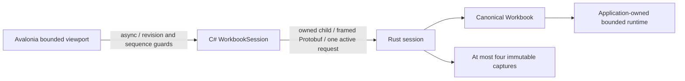

# ADR-0014: Owned local application session and bounded worksheet

Status: Implemented for Slice A review. The owner authorized a runnable application
following acceptance of ADR-0013; this implementation has not yet been reviewed.

## Decision

The .NET desktop owns one Rust `pivot-session` child and its redirected stdin/stdout
pipes. Rust owns one canonical Workbook using Limits::default and an explicit
IntegrationRuntime. It is not a listener, public daemon, hosted-model service or
second calculation engine. Child lifetime is application/session lifetime.

Reuse Protobuf, Decimal128 exact parts and the existing four-byte little-endian
length-prefixed frame shape. A separate application.v1 schema is compiled separately
from the frozen hosted descriptor set. CREATE/APPLY/READ/CAPTURE/CALCULATE/RELEASE/
CLOSE are the complete Slice A workflow. There is no file/database/provider API.
The inherited pipes need no advertised endpoint, network credentials or new peer
identity protocol. The executable path is trusted local configuration.

One request is active; at most eight accepted C# calls are outstanding, plus a
reserved close request. Frames are 1 MiB, edits at most 256, selected outputs and
read area at most 256, retained captures at most four. The UI reads at most 20x10
cells in one request, adapting visible rows to window space. Rust remains the only
owner of formulas, binding, identities and values; C# parses decimal input and
formats results, without a substitute evaluator. Research constructors are unused.

## State, cancellation and ownership

Opaque revision tokens identify the exact Rust Expected (session/state/graph)
currently owned by the serialized session. Tokens change only when Expected changes.
Mutations carry an explicit expected token, fail atomically on conflict, and are not
retried. Captures retain their original token and immutable content. Calculate
returns a distinct Rust generation; receiving S never rewinds the client's current T.
The UI additionally rejects superseded request sequences and mismatched revisions.

Cancellation while queued prevents dispatch. Once a request is dispatched, C# drains
its response, tracks any known committed revision, and discards the cancelled result.
Cancellation does not roll back an accepted edit or interrupt Rust computation.
An abandoned capture is explicitly released. This preserves frame alignment and
bounded capture ownership without inventing a concurrent cancellation protocol.
A 15-second I/O deadline makes a stalled transport terminal; an in-flight mutation
may have committed, so there is no ambiguous replay or automatic reconnect/recovery.
The workbook is volatile and lost with its child process.

CLOSE clears captures and workbook, joins runtime workers and reports remaining
charge. Disposal is asynchronous/idempotent, rejects new work while closing and
bounds exit waiting; failure can terminate the owned process tree. EOF also drops
Rust owners. Abrupt termination releases OS resources but cannot claim a graceful
zero-charge receipt. Caller-owned request/response buffers are outside the Rust
retained allocation domain and must be bounded by application policy too.

## UI and evidence

Avalonia paints only the bounded viewport; it does not allocate a worksheet-sized
control collection. Selection/formula entry, decimal edits, clear/move, row/column
scrolling, invalid drafts/repair and selected-cell errors use real Rust results.
Large work is in the child; UI handlers await asynchronous I/O. Scroll requests
coalesce for 35 ms. Errors and unsaved/session-only behavior are visible; component
timing diagnostics are opt-in. There is no save/open file feature in this UI slice.

The actual boundary tests verify decimal parts, binding/dependencies, stable moves
and coordinate reuse, drafts, atomic rollback, conflicts, S/T, bounded reads,
queued/late cancellation, capture limits, transport failure and explicit cleanup.
An opt-in GUI self-check executes real form-entry/edit/scroll paths and records a
rendered image and UI timing observations, not mocked screens. A rendered frame is
not physical display scanout, and eight UI observations are not a p95/SLA.

No ranges/SUM, copy/fill, new engine, persistence/container, hosted persistence,
formatting system, cap increase or million-cell claim is included. See the
[Slice A handoff](../handoffs/2026-10-19-application-worksheet-slice-a.md).

## Validation status

Windows/isolated Linux full CI and final real-boundary checks pass, as do the final
actual Windows/WSLg window self-checks and rendered-image inspection. The first
WSLg startup aborted natively and remains unexplained despite successful debugger
and normal reruns. Native macOS full CI and actual window/image checks now pass
from a verified APFS copy without fixes or reruns
([report](../../artifacts/macos-validation-20261020T101213Z/REPORT.md)). Preserve both
that issue and the earlier Linux backend viewport miss; neither is silently erased.
Final normal CLOSE checks release all retained generations and report zero charge.

