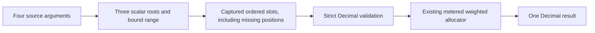

# ADR-0038: Range-based weighted allocation

Date: 2026-11-01.
Status: **Design approved with four clarifications (2026-11-01). Implementation not started.**

## Problem and source findings

ADR-0037's exact scalar allocator is accepted and unchanged. Enumerating up to 64
weight arguments is cumbersome when weights already occupy worksheet cells. This
extension should shorten the formula while preserving exact arithmetic and explicit
recipient association. It introduces a reference operand, not a second allocation
algorithm, general arrays, persistent groups or visible-only calculation.

Source inspection identifies a real distinction:

- `model/selection.rs::State::members` traverses occupied calculation points. Blank
  and absent positions are omitted; that API is appropriate for existing reductions,
  not positional weights. Its output cannot define recipient indices here.
- `expression.rs` and canonical typed evaluation currently distinguish scalar typed
  calls from aggregate range operands. A range cannot be passed as a Decimal or
  safely disguised as SUM(range).
- `structure.rs::Change::range` already specifies spatial range insertion, contraction,
  clipping and deletion. Scalar cell identity affinity is different and must stay so.
- Native WB12 graph tokens currently use tags 0..7 and worksheet tokens 0..8. Adding
  an explicit range operand needs codec validation beyond adding another scalar name.

This is source-based design. No feature code, test, benchmark, GUI or VM run accompanies
it. ADR-0023 remains parked at G3; Desktop licensing remains a separate proposal.

## Approved formula and initial domain

`ALLOCATEWEIGHTEDRANGE(total, recipient_index, decimal_places, weight_range)`

Use a distinct name to preserve the accepted scalar-list function and make its
range operand explicit. The previously illustrated ALLOCATEWEIGHTED range overload
was not a frozen API. A separate name also disambiguates native restoration of a
deleted range rendered as #REF! from a scalar error-valued weight argument.

| Argument | Meaning |
| --- | --- |
| total | Actual Decimal96, integral in the requested settlement unit |
| recipient_index | Actual Decimal96 integer, one-based within the current range |
| decimal_places | Actual Decimal96 integer, required 0..28; no formatting default |
| weight_range | One explicit, same-sheet rectangular reference with exactly one row or one column and 1..64 physical positions |

Both range endpoints must resolve to the same WorksheetId; a reference may point to
a different worksheet than the formula. Three-dimensional/external-workbook ranges
are excluded. The first three arguments allow ordinary scalar expressions. The fourth must be a
literal A1 range, optionally qualified and with ordinary dollar-axis flags, for example
`$B$2:$B$4` or `'Inputs'!$B$2:$B$4`. A singleton is `B2:B2`, retaining range geometry;
do not collapse it to a scalar reference. Bare B2, range unions, whole axes, computed
references, named/dynamic ranges and expressions such as IF(...range...) are outside
the initial grammar. Structural #REF! is accepted as a faulted range operand with
provenance, not reinterpreted as a live range or scalar weight list.

The range is vertical or horizontal. Normalize reversed endpoints to ascending physical
coordinates: B4:B2 orders B2,B3,B4, and D2:B2 orders B2,C2,D2. Preserve submitted endpoint
order, spans, qualifiers and copy flags separately for rendering/translation. A 1x1
range is valid; a genuine 2D rectangle is syntactically a range but an unsupported
shape, producing completed InvalidArgument when demanded. General row-major rectangles
are deferred: vector ordering is the smallest clear first extension.

Count every geometric position, including absent, Blank, hidden and zero positions.
N is never the occupied-member count. Keep the 64-position limit; range syntax is a
convenience extension, not permission to enlarge the arithmetic helper or global
limits. Count with checked widened dimensions before collecting positions. A live
vector over 64 positions returns completed InvalidArgument; no prefix or truncation.
This policy also applies to a valid range expanded beyond the limit by structural edits.

Example with B2:B4 containing 1,2,3:

`=ALLOCATEWEIGHTEDRANGE($F$1,C2,2,$B$2:$B$4)`

For total 10 and explicit indices 1,2,3, the settled amounts are 1.67,3.33,5. The index
remains explicit; it is not inferred from the formula cell, worksheet row or label.

## Blank, type and error policy

Preserve ADR-0037's strict Decimal semantics. An absent position, demand-created Blank
anchor, cleared cell or calculated Blank is a Blank weight and causes TypeMismatch.
Do not skip it, compress ordinals or convert it to zero. Empty String, numeric-looking
String (including leading-zero identifiers), Boolean and other non-Decimal results
are also TypeMismatch. Explicit numeric zero is valid and receives zero. Negative
weights are InvalidArgument; an all-zero list is invalid even for a zero total.

| B2:B4 | Meaning and result at total 10 / precision 2 |
| --- | --- |
| 1, Blank, 3 | Three positions; every valid recipient call returns TypeMismatch |
| 1, 0, 3 | Three recipients: 2.5,0,7.5 |
| 1, empty String, 3 | TypeMismatch; empty String is not Blank or zero |
| 1, error, 3 | Propagate the error and its existing dependency origin |
| 1, hidden 2, 3 | Three recipients: 1.67,3.33,5; visibility does not alter membership |

All positions are validated, even if only a zero-weight recipient's result is requested.
There is no new Blank option or checkbox in this version. A user who intends a zero
weight enters zero in that position; the function never changes a source cell.

Within value demand, evaluate/type-check total, index and precision left to right,
with local index bound 1..64 and precision bound 0..28 before demanding the range.
Then resolve the bound range/fault and check shape/cardinality, read weights in ordinal
order, and validate each before demanding the next. After all weights succeed, check
index<=N, positive weight sum, exact settlement total and complete arithmetic admission.
For N=3, index 4 and a Blank second weight, TypeMismatch precedes the later index>N
check. An oversized range rejects before reading any of its values. A faulted range
reports ReferenceDeleted after earlier metadata validation, never empty/all-zero weights.

Static syntax, cycle and resource validation still precede value demand under existing
rules. Operational cancellation/admission failure is not a completed type/numeric error.
Inactive lazy branches do not read range values or allocate adapter/helper scratch;
static validation is not bypassed. Existing fault provenance and zero-result rules remain.

## Range identity, structural behavior and association

Bind worksheet and SelectionId once against the transaction candidate. Live evaluation
uses that descriptor in the immutable calculation capture, not reparsed source strings,
current UI selection, a later workbook revision or endpoint occupant identities.
Share existing range geometry rules; derive this consumer's ordered slot view separately
from SUM membership. Empty slots require no new Blank anchors just to be counted.

| Change | Required behavior |
| --- | --- |
| Insert before/at the first selected axis | Shift the interval; inserted axes are outside |
| Insert strictly inside, through the last selected axis | Expand the interval and include the new positions |
| Insert immediately after the last axis | Leave the interval unchanged |
| Delete some selected axes | Contract to surviving positions under existing affinity |
| Delete every selected axis / move selection entirely past the admitted edge | Preserve deleted-range fault/provenance; never select neighboring cells |
| Rename referenced worksheet | Retain its identity and render its current name |
| Sort/move values inside the range | Bounds stay spatial; weights at ordinals may change |
| Move values into/out of the rectangle | Incoming positions contribute; outgoing values leave |
| Copy/Fill formula | Translate range endpoints under existing dollar/qualifier rules |
| Move formula itself | Retain its bound range; perform normal cycle validation |
| Filter or hide rows | No membership/order/index change |

Reuse actual fixed-edge clipping/refusal rules rather than creating a new range-affinity
policy. Preserve live SelectionIds during reframing and retire them with fault origins
when no coordinates survive. Replacement occupants or reused sheet labels cannot
resurrect a retired selection. Explicit resubmission can repair a formula normally.

An interior row inserted into B2:B4 creates a fourth position; if Blank, calls now
fail strict validation. Entering zero makes it a real zero-weight recipient. A 64-slot
range expanded to 65 becomes a completed InvalidArgument; the structural command is
not rejected solely for this function's cap. Contracting it to 64 can restore evaluation.
Deleting a zero-weight position changes N and the ordinal map: later positions shift,
and an explicit old index may become out of range. This is an explicit structural
change of specification, distinct from silently skipping a Blank in an unchanged range.

Important contrast with ADR-0037: with weights 3,1 in B2:B3 and index 1, the range function
returns 7.5 before an ascending sort and 2.5 afterward. A scalar weight list with bound
cell references may continue following the moved original cell and return 7.5. Neither
function repairs business-record association. Sorting indices with records is not a
promise that they still select those records' intended weights afterward.

The range view uses physical positions in the admitted worksheet/selection space, not
filtered viewport or display-only projection coordinates. Existing canonical structured
members keep their capture/provenance semantics; no projected display is silently
converted into a new weight table. Cross-sheet reads use the same captured workbook
state. Independent calls still cannot certify consistent parameters, completeness or
unique indices. No persistent recipient identity or keyed group is introduced.

## Position-preserving collection and dependencies

Add a bounded, snapshot-owned ordered-slot accessor for this consumer. For an admissible
vector it returns exactly N logical slots in ascending coordinate order, each occupied
NodeId or explicit missing/Blank marker. Use metered point lookups through the immutable
row/column index, not a scan of the workbook or State::members followed by guessed gaps.
Do not deduplicate slots: two positions sharing a graph node are still two recipients.
Dependency sets may deduplicate NodeIds independently of the ordinal value list.

Selection subscription and membership invalidation must notice absent/Blank->Decimal,
Decimal->Blank, occupant movement, descriptor reframing and retirement. Existing SUM
point membership and Blank exclusion stay unchanged. Never put Blank anchors back into
the populated calculation index, undoing the accepted ADR-0036 invariant correction.
Ordinary within-request node-value reuse is allowed; no new persistent weight/allocation
cache or hidden full-group memoization is proposed. Each scalar call repeats admitted
collection and delegates once to the existing allocator.

A domain-rejected shape/size needs a bounded dependency policy, not a walk through a
million-position rectangle before returning InvalidArgument. Recommend treating that
range operand as a deterministic domain error: retain its descriptor subscription but
add no range-member data dependencies while its shape/count is inadmissible. Scalar
metadata dependencies remain. Retired references are fault operands, not empty ranges.
For an admissible vector, include all current occupied slot dependencies, including
ordinary static cycle validation even in otherwise inactive branches.

This policy is specific to the new range consumer. When a descriptor becomes admissible
again, restore its member dependencies and cycle-check the entire candidate before
publication; an emerging cycle refuses atomically. Restoration/import must derive this
policy from current geometry, not trust a saved dependency count or truncated member
list. Unknown/cross-context SelectionIds, inconsistent placement and malformed descriptors
remain invalid transfer/document state, not legitimate missing weight cells. This domain-error/dependency boundary is approved, with mandatory invalidation and
cycle-restoration evidence.

## Arithmetic, work and memory

After strict collection, call ADR-0037's canonical metered scalar allocator with the
same total, index, precision and N ordered Decimal values. No new quota/remainder,
ranking, tie, normalization or SUM algorithm is allowed. Equal positive ranges match
ALLOCATE; any range matches the corresponding explicit ADR-0037 weight list. Preserve
final-award-only validation and the proper-nonzero-subset admission proof, including
inserted zero terms and final total normalization. Nonmonotonicity across changed
specifications remains documented. Formatting, division, ROUND and SUM are unchanged.

Approve at most **8 KiB explicit range-adapter scratch**, separately charged before
collection/storage. Prove fixed layout for at most 64 slot descriptors and scalar
argument staging, excluding existing separately charged evaluator values/error payloads.
The existing **16 KiB weighted reservation**, 9,472-byte helper layout, limb ceiling
4,096+16,384*N and numeric visit reservation 4+16*N remain unchanged. Report adapter
and helper storage separately; do not hide the new adapter inside old accounting.

Charge existing visits for descriptor/position steps and each actually inspected index
node, in addition to ordinary value-evaluation and numeric charges. Introduce a bounded
metered point-lookup path rather than assuming a fixed cost for an unmetered AVL search.
Check cancellation during index traversal and between slots, then retain the existing
within-division/ranking checks. No speculative large-range allocation or work on
nonadmitted geometry. Release adapter and numeric charges on every exit; failures
and reads do not mutate workbook/capture state. Audit canonical, structured, restored
and direct range-aware entry points; a detached numeric typed call cannot forge a
worksheet resolver or bypass collection/admission.

Slot value demand must use the existing explicit evaluator task stack and the same
invocation's visits, memory and cancellation context. Do not launch a fresh evaluation
per position, reset budgets, recursively evaluate member graphs on the Rust stack or
resolve against a detached capture. Suspended/nested range calls retain their adapter
charges until completion; additional frames require independent admission.

No new arithmetic memoization is needed for this bounded first version. Existing node
memoization can avoid repeated leaf evaluation within one request. If repeated range
lookups plus allocation miss objectives, diagnose and reconsider the design; do not
silently add shared groups, raise limits or omit charges to obtain a pass.

## Representation and compatibility proposal

Introduce an AST range-reference descriptor, reused lexically with current address
parsing but without a SUM kind. Lower to an explicit bound range operand, carrying
SelectionId plus the worksheet geometry/source endpoint metadata already needed by
native range references. A deleted range uses existing validated range fault origin
semantics. It is never a Decimal, SUM result, fake variable or general PivotValue array.

Propose **typed operation 21**, fixed arity four, for ALLOCATEWEIGHTEDRANGE, plus a new
range-operand token: graph/selection tag 8 and worksheet tag 9 are currently unused.
These tag numbers require a complete encoder audit before freezing. The program/transfer
validator must require three scalar roots and one live range-reference or deleted-range
fault root. Arity alone is insufficient. A fault root must carry a valid range-kind origin (or an explicitly authored empty
#REF! origin), not a forged scalar-reference origin. The range operand can feed only this operation;
standalone, nested-as-scalar, forged-ID and other-consumer uses reject statically.
The conceptual flow is:

Program lowering creates a dedicated range-call task/expression with a scalar result,
not a public range-valued result. Plain typed::apply with four scalar values cannot
execute operation 21 as an accidental one-weight allocation. The range-aware canonical
entry requires the captured selection context and delegates arithmetic to operation 20.

Approve **WB13** for the new native token shape and validators, rather than claiming
WB12's scalar typed-call representation is sufficient. This is a real format proposal,
not an arithmetic change. Following the current repository's format-cut policy, propose
WB13-only validation: no WB12 reader or migration is included. This means current WB12
files are not opened by the new reader; retain their source/fixtures/build evidence.
That compatibility impact is explicitly accepted under the pre-release format policy.

Propose retaining **private session v13, hosted v1 and CB5/CB6** if inspection confirms
no message/payload field change. Formula requests already carry source; numeric/error
results need no new type. Native clipboard records already carry rendered formula text,
effective endpoints/qualifiers and range fault origins. Extend their AST/token handling
and validation without changing those fields; the distinct function name preserves the
range interpretation of rendered #REF!. Hosted v1 gains no remote range-valued argument.
If actual serialization/metadata needs differ, return for review before changing these
versions; do not smuggle missing authority through source text or a fallback format.

Save/reopen/import must validate source spans, effective geometry and sheet identity,
selection registration/subscriptions, live versus retired authority, operand shape,
arity, slot-derived dependencies and cycles atomically. Existing unknown-version/token
refusal remains strict. New files must not be presented as readable by old engines.

## Alternatives and explicit review decisions

| Alternative | Recommendation |
| --- | --- |
| Separate ALLOCATEWEIGHTEDRANGE name | Prefer: explicit operand kind, scalar contract unchanged, fault restoration unambiguous |
| Overload ALLOCATEWEIGHTED's fourth argument | Natural shorter syntax, but singleton/fault interpretation and clipboard restoration need extra discriminator rules; defer |
| One row or column | Prefer for clear ordinal order and minimal initial shape contract |
| General rectangles with row-major order | Coherent possible extension; defer extra renumbering/UX cases |
| Blank->zero option | Defer; strict default matches ADR-0037 and distinguishes missing data from intentional zero |
| Skip empty positions / collect occupied selection members | Reject: changes recipient indices and can misallocate money |
| Permanent expansion to scalar cell identities | Reject: loses spatial range membership and structural affinity |
| Larger range cap or uncharged batching | Reject for this extension; keep 64 and existing budgets |
| New arrays, keyed groups or allocation-result cache | Outside scope |
| Preserve WB12 by disguising the operand as SUM | Reject: changes meaning and hides required token authority |

## Required implementation validation

Independent Python Fraction and .NET BigInteger oracles must compare the ordered dense
slot specification with the corresponding scalar allocator, including every valid index,
zero/negative totals, ties, rescaling, mixed scales, extremes and actual production SUM
orders with zeros inserted. Exercise source reversal and horizontal/vertical equivalence.
For 1,Blank,3 verify N=3 and failure for all indices; after entering zero verify the
three-recipient outcome. Include absent, anchored, cleared, calculated Blank, empty
String, Boolean, error and repeated-NodeId slots, checking deterministic fault demand.

Test 1/64/65 positions, enormous but rejected descriptors without data enumeration,
2D shapes, index bounds, invalid precision, inactive branches, indirect/self cycles,
shape transitions and renewed dependency/cycle validation. Test absent->zero->Blank
invalidation, old captures after weight/geometry changes and same-capture consistency.
Verify inserted Blank versus explicit zero, boundary affinities, contraction/retirement,
fixed-edge cases, sort-association changes, Copy/Fill mixed dollar flags, cross-sheet
copy/rename and filtered hidden rows without visible-only semantics.

Validate all new instruction shapes at parser, lowering, direct/context APIs, trusted
transfer, native document and CB5/CB6 boundaries. Forge missing/wrong-context selection
IDs, scalar/range misuse, malformed tags/arity/source bindings and fault origins. Test
WB13 Save/reopen and obsolete-version refusal, native clipboard roundtrips with live
and deleted singleton/vector ranges, real C#–Rust sessions, editable repair and filters.

Declare resource corpora with 16,384 base cells, 64-position vectors, a complete group
SUM and 256 range calls, four changed-input samples and four retained captures. Compare
with the identical scalar-list workload. Include dense, missing/Blank, zero/tie, wide
normalization/Overflow and over-limit rejection modes; record exact extra positions,
point-lookup work, adapter/helper memory, cancellation and zero final charges. Count
index traversal, dependency preparation and value demand, not only the arithmetic.
Keep the original one-second bounded-operation and 256/512-MiB charged-memory objectives;
these remain observed core samples, not GUI latency, RSS or percentiles.

Require final local CI, strict Clippy, all-feature regression and all-six-target headless
parity, with macOS x64 labeled Rosetta. Unlike the numeric-only ADR-0037 change, require
managed and Native AOT GUI qualification on all six targets for new formula/reference,
clipboard, structural rendering and WB13 paths, with the ordinary graphical-terminal
consent mechanism and short launchers. No GUI or platform run occurs during design.
Retain original failures, selected-source qualifications, verified archives/cache pruning
and final canonical per-project cloc. No quota increase, licensing implementation,
history integration or extra allocation policy is included.

## Design disposition — 2026-11-01

**Approved with four mandatory clarifications.** The separate
ALLOCATEWEIGHTEDRANGE function, explicit index/precision, single-row or single-column
literal range and 1..64 physical positions are accepted. Both endpoints bind to one
worksheet; cross-sheet references from the formula remain allowed. Singleton range
syntax stays explicit. No scalar-function overload or implicit recipient index.

Strict Blank semantics are accepted: every absent/Blank position retains its ordinal
and produces TypeMismatch, while explicit zero is a valid weight. Empty String,
Boolean and numeric-looking String remain invalid. Visibility never removes positions.
Spatial range behavior, existing SelectionId/structural affinity and the documented
sort distinction from scalar identity-bound references are accepted. Neither function
repairs business-record association or certifies complete consistent index membership.

1. **Preserve positional multiplicity.** Collection must produce exactly one slot per
   physical position, including absent positions and repeated GraphNodeIds. Dependency
   sets may deduplicate identities, but the input vector cannot. Add an independent
   regression that distinguishes this accessor from occupied-member SUM enumeration.
2. **Bound invalid geometry and restore dependencies.** Inadmissible geometry retains
   descriptor subscription without traversing member values or adding member edges.
   Geometry changes must invalidate results reliably. Becoming admissible restores
   dependencies and cycle-validates the whole candidate before atomic publication.
   Expansion, contraction and repeated invalid/valid transitions must not leave stale
   errors or stale values. Restored/imported state must derive these edges correctly.
3. **Validate authority as well as arity.** Operation 21 requires three scalar roots
   and an authorized range operand or valid deleted-range fault. Four scalar values
   cannot fall back to ordinary weighted allocation, and range operands cannot leak
   into scalar contexts or unrelated functions. Proposed graph tag 8 and worksheet
   tag 9 are provisionally accepted, subject to a complete codec/entry-point audit.
4. **Keep WB13 compatibility explicit.** WB13-only is approved for the new operand
   representation. No WB12 reader or migration is required under the pre-release
   policy. Preserve WB12 artifacts as historical evidence or version-refusal fixtures,
   not supported documents. Private v13/hosted v1/CB5/CB6 may remain only if the audit
   confirms their existing fields preserve range and fault authority; actual missing
   fields require further representation review.

The additional 8-KiB adapter reservation is accepted and must be independently charged,
not absorbed into the existing 16-KiB numeric reservation. Meter actual index-node work
alongside existing visits; retain one task stack, immutable capture and cancellation
context. No per-slot fresh evaluation, budget reset or uncharged entry path. Reuse the
unchanged ADR-0037 arithmetic, limb/visit bounds, actual-SUM admission and original
one-second/256-MiB steady/512-MiB peak objectives. No global resource increase.

Required qualification includes independent Python/.NET oracles, actual SUM, missing/
Blank/zero/error slots, structural membership/retirement, dependency/cycle restoration,
Copy/Fill, sort/filter interaction, WB13 persistence/obsolete refusal and CB5/CB6.
All six targets require headless CI, managed GUI and Native AOT qualification; macOS
x64 remains Rosetta. Preserve observed-maxima rather than percentile claims, charged
memory scope, source qualifications, original failures and verified retention/cleanup.

This disposition approves the design only. No implementation, benchmark or platform
execution has occurred. Keyed groups, persistent recipient identities, automatic repair,
arrays/spills, visible-only allocation, fairness/history state, financial subsystems and
Desktop licensing implementation remain excluded. ADR-0023 stays parked at G3.
