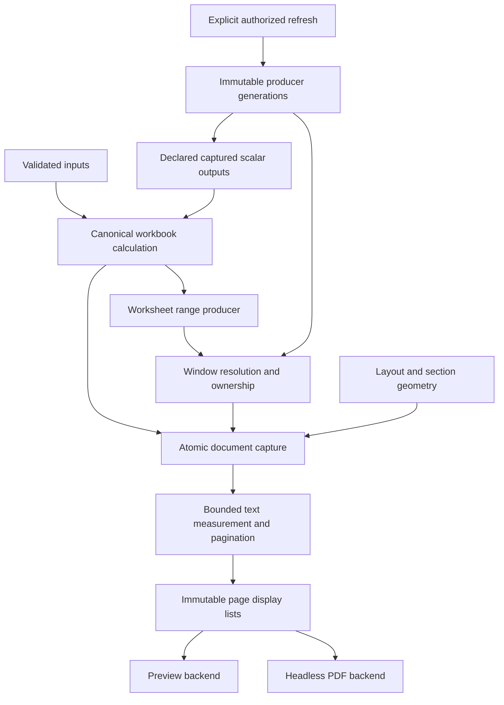

# ADR-0039: Named Windows, data binding and document composition

Date: 2026-11-01.
Status: **Architecture accepted with three clarifications (2026-11-01). Implementation requires separate authorization.**

## Design review disposition

The architecture is accepted with three mandatory clarifications:

1. Before section geometry is promoted, qualify an invoice header with narrow metadata
   columns, wide line-item descriptions, distinct totals/payment geometry, interacting
   horizontal/vertical boundaries, and selection/hit testing across gaps and seams.
   If ordinary layouts frequently refuse, revisit the model rather than require user
   workarounds. Architectural acceptance is not evidence that this usability gate passes.
2. Grid-to-Text conversion remains lossless and limited to blank, unreferenced
   rectangles. The UI must explain refusals involving values, formulas, inbound
   references or other dependencies. Reverse conversion requires empty Text and the
   original reservation, restoring the exact grid and formatting.
3. JSON, named and direct-cell inputs must all resolve through the declared InputId
   contract. Direct-cell input grants no arbitrary-coordinate editing authority.
   Preserve exact Strings/leading zeros, decimal lexemes and Blank/empty-String
   distinctions; reject the whole invocation on required-input or validation failure.

Retain the six implementation scopes in their stated order, starting with unbound
Grid identity/references, not PDF. Resource ceilings are accepted as provisional
admission policy, not measured guarantees or increases to global calculation limits.
No feature implementation, platform validation or backend selection accompanies this
review disposition.

## Purpose

Make a workbook a reusable business-document model: authored inputs and formulas,
independent named content surfaces, coherent data binding and deterministic page
composition. This architecture covers variable-length invoices and similar documents;
it does not implement a word processor, database framework or PDF engine.

The [future-direction proposal](../proposals/pivot-future-direction/pivot-future-direction.md)
is the motivation. This ADR resolves its identity and ownership questions. Detailed
contracts are in [Window references and binding](../architecture/named-windows-and-binding.md)
and [geometry, Text and document layout](../architecture/document-composition.md).
The [design handoff](../handoffs/2026-11-01-named-windows-design.md) identifies review risks.

## Existing foundations and gaps

Inspection of `pivot-workbook/src/projection.rs` finds distinct producer, generation,
schema, field, output and projection UUIDs, immutable keyed rows, charged shared
ownership and bounded frames. `structured.rs` binds portable output identities to
shared captured scalar leaves. `pivot-core/src/captured.rs` currently supplies
**Decimal96 or fault**, not arbitrary typed values. Those are useful seams, not a
production Window implementation: the proofs are opt-in, fixed-schema, non-savable
and have experimental publication/coordinate restrictions.

Existing scalar CellId references follow identity; SelectionId rectangles follow
spatial membership. Neither should be replaced by rendered row ordinals. WB13 is
the current native format; private v13, hosted v1 and CB5/CB6 are current baseline
contracts. Historical proof-version descriptions are not current product versions.

## Decision: workbook-owned objects, one calculation authority

A workbook owns a Window directory, producer directory and document-layout directory.
A Window is not a worksheet rectangle. Placement is a separate object referencing a
WindowId; moving or repeating a placement does not move Window content. A Window
can have several placements and survives removal of its last placement. Explicit
Window deletion retires its identity and faults inbound references atomically.

Each Window has a non-reused UUID, unique workbook-wide name, independent finite
A1 axes, local geometry/formatting and one content kind (**Grid or Text**) plus one
ownership mode (**unbound or bound**). These dimensions are independent. Window and
worksheet names may coincide because `|` and `!` identify separate namespaces.
Names use NFC normalization followed by Unicode default case folding, with the
Unicode version pinned by the format contract and collisions refused; original
spelling is retained for display. Rename never changes identity.

Unbound Grid owns sparse authored cells and formulas in the canonical workbook
calculation graph, using scope-qualified CellIds and existing structural rules.
Bound Grid owns no editable computational cells: it projects an authorized producer.
Unbound Text owns a bounded rich-text tree. Bound Text projects a producer's typed
text document; table-to-text concatenation is not an implicit conversion. Text exposes
one logical A1 content object; B1 and other cell addresses are invalid. Text A1 is
available to presentation references, not scalar formula arithmetic.

The source/output dependency graph must be acyclic before candidate publication.
The diagram's producer-to-model path is permitted only through declared source
outputs. A worksheet producer cannot feed a formula that transitively supplies that
producer. No iterative publication or implicit fixed-point evaluation is allowed.

## Reference and producer decisions

Adopt `Sheet!A1` and `Window|A1`, including quoted names and `$` copy flags. Unqualified
A1 refers to the author's Grid scope. Resolve names at authoring against an expected
revision; store identity, source spans and copy metadata. Never restore by resolving
old display text. Bound coordinates resolve a stable source item identity, not a
per-refresh ordinal. Details, including ranges and fault behavior, are normative in
the reference contract.

Worksheet-range producers are live at **committed coherent generations**. External
producers refresh explicitly and publish immutable snapshots. Failure retains the
last successful generation with diagnostics; no first success means unavailable.
Recalculation, viewport reads, capture and PDF rendering never execute queries.
Neither binding nor changing ownership may silently copy data or enable writeback.

**Blocking formula-consumption decision:** worksheet-bound scalar references alias
the authoritative source CellId with a Window-lifetime guard; they do not allocate a
new value node. External-bound Decimal fields use shared captured scalar leaves keyed
by producer/item/field identity, reusing the ADR-0020 boundary. Non-Decimal external
fields remain presentation-only in this initial architecture; formula binding refuses
with an explicit unsupported-type diagnostic. No typed-core expansion is smuggled
into Window work. Missing/deleted sources fault rather than reading a cached value.
Arbitrary external record reductions and range operands are deferred. Ordinary
worksheet-range producers still use existing source SelectionIds where supported.

## Geometry, Text and pages

Choose independent geometry partitions: row bands select column-width profiles;
column bands select row-height profiles. Their cross-product is evaluated, not stored
as independently editable two-dimensional regions. The mapping contract addresses
nonuniform row/column boundaries, rectangular selection and deterministic hit testing.
Section Breaks never alter addresses, identities, formatting or physical page breaks.

Text uses native paragraphs and typed runs, never HTML execution or blind template
substitution. Conversion of a nonempty grid is an explicit data transformation, not
a destructive merge. The initial lossless conversion contract is deliberately narrow:
blank, unreferenced rectangles only; dormant grid anchors/formatting are preserved.
Nonempty/formula/referenced selections refuse with a diagnostic, and existing text
can instead be inserted into a separately created Text Window. A broader converter
requires its own reviewed mapping, not an implementation-time guess.

Layouts place both ordinary worksheet/page content and Windows. Default static
content repeats every page; default flowing Windows continue until exhausted.
Once/first/last/every visibility is explicit. One ordered body flow plus reserved
page bands avoids competing unconstrained expanding objects and pagination cycles.
Final-page totals participate in bounded pagination; no synthetic worksheet rows or
computational identities are created. See the composition contract for exact policies.

## Invocation and immutable capture

A versioned template input contract declares stable InputIds, target identities,
types, required/default rules and bounded collection schemas. JSON, named-reference
and direct-cell submissions resolve to that same contract. Unknown, duplicate,
missing-required, conflicting aliases, invalid-type and over-limit fields refuse the
entire invocation. Strings remain exact, including `001234`; no automatic numeric
inference. Decimal JSON tokens are parsed as exact decimal lexemes, never binary
floating point. Null requires an explicitly nullable field and maps to Blank only by
contract; it is distinct from empty String. Formula injection is not a value input.

An invocation forks an immutable template root, applies all inputs atomically to an
isolated instance, calculates canonically and captures without modifying the template.
Collection inputs publish invocation-local producer generations. Names are resolved
to stable InputIds when defining the contract; callers do not authorize arbitrary
cell edits. Deleted targets invalidate the contract. No implicit input repair.

DocumentGenerationId identifies a capture containing template/instance identity,
workbook and computation tokens, selected producer generations, Window definitions,
layout/geometry/format roots, resolved typed runs, assets, locale and font manifest.
Capture pins exact roots atomically; selected generations may differ in refresh age
but cannot be mixed during calculation. The render policy defaults to refusing
missing, failed-refresh or explicitly stale required sources; callers can explicitly
permit retained successful snapshots, with provenance recorded in the result.
No claim is made that an external database is fresh merely because refresh succeeded.

Late refresh completions require matching producer configuration/refresh tokens;
obsolete completions are discarded. Concurrent captures retain old generations.
Cancellation or admission failure publishes no partial head or output file; temporary
output is discarded. Render completion need not match today's workbook head because
it produces the explicitly captured generation, not a new workbook state.

## Renderer, compatibility and resource boundaries

Rendering depends on capture/display-list interfaces, not Avalonia or live sessions.
The canonical model resolves values; text measurement shapes Unicode; layout creates
pages; preview/PDF backends consume the same display list. Pin font files, shaping
configuration, locale, page units and rounding. Missing fonts refuse reproducible
rendering rather than silently substitute. Use bounded image decoding, no network
asset fetch, no active content and a hyperlink allowlist. PDF requirements include
embedded permitted fonts, selectable Unicode text, reading order, semantic tags and
link annotations. Font redistribution rights and PDF conformance must be qualified
before selecting a backend. No dependency/product recommendation is made here.
Stable page geometry is required; byte-identical PDFs additionally require normalized
metadata/IDs and a pinned backend. Accessibility and complex-script fixtures are
release gates, not assumed capabilities of an unspecified library.

Production persistence needs a **new native format after WB13** for directories,
owned Grid scopes, Text trees, producer descriptors/snapshots, geometry, placements,
inputs and identity/fault metadata. Freeze its number only with the codec change.
Reopen preserves selected snapshots and reports disconnected authorization; it never
queries. Credentials are referenced through local authorization, never embedded.
No historical reader/migration is implied. Structural restoration validates complete
bindings, cycles, retired IDs and source descriptors before install.

Private protocol requires an explicit version cut for tagged Window locations,
generation-qualified reads and new commands. Hosted v1 is unchanged until a separate
invocation API is approved. Existing CB5/CB6 cannot encode these objects: refuse native
Window Copy/Cut before clipboard mutation until a new reviewed envelope exists.
An explicit values-only copy can use typed text export with the existing identifier
rules; it is not a native round trip. Future native duplication remaps owned IDs,
retains authorized external identities, and never resurrects deleted producers.

Existing global calculation/domain limits remain unchanged. Document admission is
separate and subordinate to the same enclosing allocation domain: proposed initial
ceilings are 64 Windows, 32 producers, 100,000 projected records total, 100,000 rich-text
runs, 8 MiB UTF-8 text, 1,000 pages, 10 million metered layout operations and 128 MiB
transient renderer charge per job. These are **proposed admission ceilings**, not
measured performance claims or permission to raise the global budget. Shared pinned
generations are charged once; pins, indexes, glyph buffers, decoded assets and output
buffers are charged separately. A job can refuse below any count cap because memory
or work admission failed. Stream output with bounded buffers; charge retained pages
and concurrent jobs, cancel between bounded units, cap retries/reflow, and reject
overflow before publication. Engine cell limits do not bound text, pages or images.

## Alternatives and consequences

| Alternative | Decision and consequence |
| --- | --- |
| Merged cells / print areas | Useful static layout, insufficient independent identity, producer lifetime and flow; retain ordinary content instead of forcing all content into Windows. |
| Window as worksheet rectangle | Rejected: source movement, variable length and placement would conflate three coordinate spaces. |
| Duplicate bound cells | Rejected: duplicate authority and per-record graph materialization. |
| External document templates | Possible integration later; primary design stays workbook-owned so business logic and layout share versioned capture. |
| Editable 2D geometry regions | Rejected initially: conflicting seams and potentially quadratic metadata; independent partitions have an explicit computed map. |
| HTML / general document runtime | Rejected: unbounded layout/security surface and divergent measurement; bounded native tree is portable and inspectable. |
| General typed captured sources immediately | Deferred; Decimal-or-fault seam is real today, while presentation can preserve all canonical value types. |

## Proposed sequence and acceptance gates

These are proposed implementation scopes, **not authorization or assigned ADR numbers**.

1. Window directory, unbound Grid scopes, references and lifecycle; freeze codecs,
   protocol and clipboard refusals. Verify identity/copy/fill/deletion/cycles/reopen.
2. Worksheet producers and external immutable fixture producers; coordinate-to-item
   binding, captured Decimal leaves and coherent publication. No database provider
   framework. Verify repeated keys, holes, refresh races, stale/fault policy and budgets.
3. Independent geometry partitions and one shared viewport/layout mapping. Verify
   structural boundaries, seam hit testing, selection and unchanged computation.
4. Native Text, inline presentation bindings and guarded conversion; qualify Unicode,
   accessibility, retirement protections and admission, without history integration.
5. Immutable document capture, bands/body flow, deterministic measurement and preview;
   qualify sibling competition, first/last content, oversize/empty and bounded reflow.
6. Typed invocation and headless PDF backend under a separately approved implementation
   scope; qualify exact inputs, template isolation, fonts, tags and atomic output.

Each scope requires design review of concrete API/codec details, owner authorization,
appropriate six-target validation planning, diagnostic LoC and verified retention.
This design milestone runs no feature, performance, GUI, AOT or platform checks.
No implementation throughput promise is made for the proposed admission ceilings.

## Exclusions

No nested Windows, arbitrary writeback/query language, scripting, HTML/CSS runtime,
dynamic arrays, automatic record repair, full word processing, PDF implementation or
distribution, email, signatures, scheduling, multitenancy, licensing change or history
integration. ADR-0023 remains parked at G3. ADR-0038's original cold-build failures
remain unresolved historical failures; this design does not requalify them.
