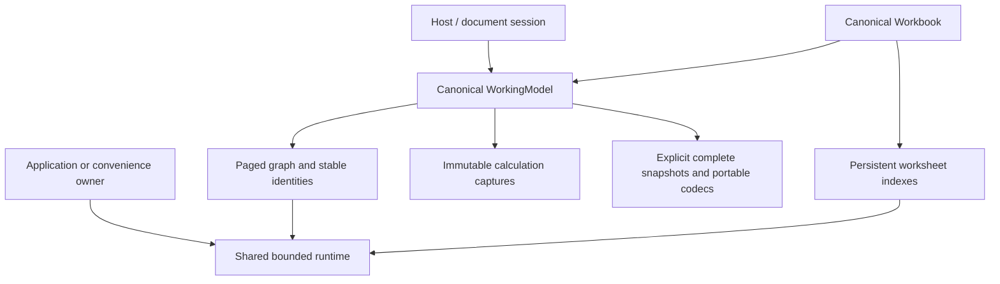

# Canonical engine consolidation

Owner authorized: 2026-10-19. Status: implemented; Windows/Linux/native macOS validation complete; implementation review pending.

Pivot has no deployed consumers requiring a dual-engine migration. The persistent
paged graph and ownership-aware workbook are the sole target runtime. Keep crate
responsibilities, stable identities, atomic expected-state edits, invalid drafts,
local versus complete validation, exact Decimal96, captures, ports, portable
restoration, replay/publication and deterministic resource cleanup.

Historical recovery point: `3a6fd9719f491a9236dbf0197ed9d4fb7ade3e24`.
That revision contains the final reference implementations and the three-platform
[readiness analysis](../performance/persistent-workbook-readiness.md), preceding
[bulk foundation](../performance/persistent-workbook-bulk.md), workload definitions,
allocation/RSS caveats and migration rationale. Git is the source archive; no
parallel archived engine tree will be added. Ignored raw artifact directories are
local evidence and must be retained separately when transferring the repository.
Frozen numerical/protocol/portable fixtures remain specifications.

Remove mutable full-copy graph/workbook backends, selector enums/feature gates,
activation bridges, redundant differential suites and comparison-only APIs. Retain
bounded workload generation and useful allocation/lifecycle instrumentation.
Complete snapshot/portable materialization remains an explicit admitted operation,
not an alternative editable backend. Port validation must have one implementation.

Convenience construction shares the lazy runtime; application constructors accept
an explicitly owned runtime. Prepare large edits off the UI thread and bound caller
input/result buffers outside the retained allocation domain. No capacity increase,
new formula features, database/container, C# IPC or Avalonia is included.

Required completion evidence: default strict lint/tests, .NET/parity/portable/real
IPC, document Save/Open and atomic transaction/lifecycle regressions, canonical
Release workloads and Windows/Linux/native APFS macOS validation. Native validation
requires a fresh source copy; historical runs do not validate consolidation.

## Implementation and removed inventory

WorkingModel owns one mandatory runtime/graph handle and its revision. Workbook
owns one mandatory worksheet root plus WorkingModel. Captures/results retain only
canonical roots and their runtime. There are no storage/capture backend enums,
reference constructors or activation bridges. Convenience ownership is shared;
explicit owners can refuse shutdown until captures/results release and cleanup drains.

GraphImage is an owned complete definition image for codecs and diagnostics. It is
not a mutable graph: it cannot add/change nodes, stage branches or select a backend.
Its private port helpers are the single port validation/authoring rules, reused by
canonical graph mutations; complete validation handles all affected nodes. Snapshot
execution and persistent calculation share the decimal expression executor.

Removed files include full-copy worksheet prototypes (scaling.rs/structural.rs),
reference local evaluator, four prior core comparison examples, four workbook
prototype examples, the legacy host probe and nine obsolete experiment runners/
analyzers. The surviving bulk runner uses only canonical graph/workbook operations;
its individual/batch options select mutation granularity, not engine representation.
The immutable-index comparison environment switch is removed. Allocation profiling,
OS measurement, bounded generators and fixture assertions remain.

Old differential core cases now compare canonical branches, including immutable
snapshot results and explicit expected arithmetic. The workbook differential case
is replaced by a 256-transaction independent scalar oracle preserving checks for
stable IDs, exact decimal/source metadata, rollback, cycles, and pinned generations.
Shared projection/formula suites run through convenience and explicit-runtime
construction; transaction admission/cancellation/churn and portable/document/host
regressions remain. Removed prototype tests validate obsolete representations;
their product invariants are covered by canonical suites and retained lifecycle tests.

## Current validation boundary

Default CI passes 275 Windows / 276 isolated WSL2 Linux / 276 native macOS tests;
all-feature coverage passes 291/292/292. Strict lint, .NET Release, decimal/protocol/portable specifications,
real IPC and document/lifecycle regressions pass. All 99 three-platform matrix children plus one
targeted viewport repeat pass correctness and final zero-charge checks. The original
Linux small fan-out viewport p95 miss (5.343 ms vs <5 ms) is retained even though
its matched repeat passes (3.381 ms). This is a tail-latency limitation for review,
not evidence for a threshold/cap increase. Fresh native APFS validation passes
with 280 matching copied source hashes before documentation updates, no source
fixes/reruns, zero final domain charges and all native review targets passing.
Normal pressure in eight native samples and completed-child high-water do not
supply live RSS enforcement or invalidate historical warning-pressure findings.
