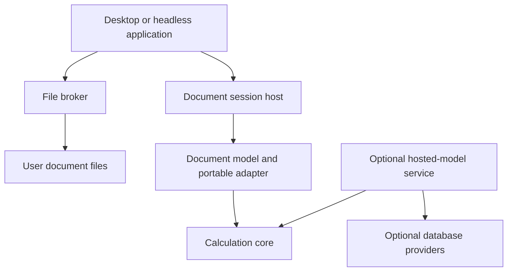

# Document ownership and local lifecycle

Status: Accepted ADR-0009 architecture. [Slice A](document-foundation.md) implements
a thin in-memory one-graph session. [Slice B](experimental-file-broker.md) now adds
experimental Rust headless file operations. C# broker, bulk transfer, worksheets,
Revert/autosave and document RPC remain unimplemented designs. The broader lifecycle
below is architectural direction; the Slice B page records its narrower actual profile.

## Ownership

The calculation core knows graphs and immutable calculation snapshots, not files,
worksheets, authorization or service ownership. A Rust document layer owns portable
definitions, exact value representations, document metadata and future projections.
The application/session host owns live document sessions and serialized edits. The
session is deliberately thin: it reuses core staging, binding, restoration and
evaluation, without duplicating WorkingModelService attachments, retained receipts,
publication or authorization machinery. The optional hosted-model service remains
a separate capability; loading a document
does not allocate a publication or durable registry entry.

In desktop mode, the C# application initiates user-authorized file operations. Its
file broker owns paths, handles, file fingerprints, conflict checks and replacement.
Rust validates content and owns semantic edits and calculation. C# does not parse,
bind or evaluate formulas. New/Open creates a private Rust document session scoped
to the authorized client. The broker supplies bounded content or a future scoped
stream capability; never an unrestricted daemon path. A headless Rust application
can compose the same document logic and a Rust broker in process.

## Proposed commands and transitions

These are semantic operations, not allocated RPC messages or public Rust APIs.

| Operation | Proposed behavior |
| --- | --- |
| New | Create a new DocumentId and session with one empty graph; no path; saving is required even before the first edit |
| Open | Broker acquires a stable read and fingerprint; Rust checks compatibility and validates all authoritative content privately; expose a session only after complete success |
| Edit | Expected-session/state check, stage atomically, install new document state; graph changes also advance affected graph revisions; no file write |
| Calculate | Capture graph definitions, inputs, settings and revision vector; release edit gate; return generation-tagged results without mutating saved definitions |
| Save | Require associated writable target; otherwise use Save As; export one immutable state, safely persist it, then acknowledge that exact captured state |
| Save As | Export to a user-selected target; existing target requires explicit replace consent and conflict checks; associate the new path only after verified success |
| Close | If unsaved, offer Save, Discard or Cancel; failed/uncertain Save keeps the session open; release resources only after the decision completes |
| Revert | Explicitly discard unsaved state after confirmation; read and validate the current associated file into a replacement session; swap only on success |

Save As preserves document/graph/node/port identities because it saves the same
logical document at another location. The old file remains a separate saved copy;
neither location is automatically linked. Two copies may therefore share identities.
Host sessions always namespace runtime maps. A future Duplicate/Fork operation
must explicitly remap identities and bound references together; Save As does not
silently perform that operation. Reopening a path already open in one application
should activate its session, unless the user explicitly requests an independent copy.
DocumentId means logical ancestry; it is never a file-conflict key or authority to
merge sessions or recovery checkpoints. A future file broker must combine session,
physical target fingerprint and saved baseline when distinguishing copies.

Revert allocates a fresh SessionId even if DocumentId is unchanged; old calculations
and pending commands cannot apply to the replacement. Closing a session cancels or
detaches work under bounded policy; any late result is rejected by session identity.

## Dirty state and concurrent saves

Every content edit installs a new DocumentStateId. Keep the last verified saved
state and associated SavedFileVersion separately. Dirty means current content does
not match that saved checkpoint, or the document has never been saved. Presentation
edits mark dirty even when graph revisions are unchanged. Recalculation, selection,
scroll position and session diagnostics do not mark dirty unless a future explicit
document preference makes specific presentation state persistent.

Undo can restore a prior state/checkpoint and become clean; a no-op must not advance
state. If a future implementation cannot prove semantic equality after a different
edit path, conservatively keep dirty rather than compare only revision counters.

Serialize file writes per session and coordinate multiple sessions targeting the
same file. A save captures state S and file baseline F. Edits may continue while S
is encoded/written. Successful acknowledgment records S as the saved checkpoint;
if current state is now T, the document remains dirty. Never mark T saved because
S reached disk. The proposed export ticket binds session, state, version and digest;
acknowledgment is idempotent within that live session, not a durable mutation receipt.

Cancellation before replacement leaves the old file and dirty state. Cancellation
or disconnect after replacement cannot establish failure. The broker must resolve
the exact export version/digest before updating the saved checkpoint or retrying.
If the broker disappears, memory can remain usable but saved status is unknown.
No automatic repeat of an uncertain Save As to another target.

## External changes and multiple applications

Record an opaque baseline fingerprint combining file identity, size/time hints and
a strong content digest. Metadata alone is insufficient. File watchers are hints;
verify the baseline before saving. If externally changed, deleted or replaced,
offer Reload/Revert, Save As, or explicit overwrite of the newly observed version.
No silent merge, overwrite or reload that discards edits. A clean document can
report a newer file without immediately replacing the visible state.

Use a cooperative per-target writer reservation held through baseline verification
and replacement. It must survive replacement of the old inode/file object; a lock
on that object alone is insufficient. Same-application paths, case aliases and
hard links need identity-aware coordination. Read-only second opens are acceptable;
multiwriter collaborative editing is outside scope.

An uncooperative writer can race a fingerprint check and replacement: ordinary
portable file APIs do not supply a universal content-compare-and-swap. The initial
contract must state this limitation. Do not advertise protection against arbitrary
concurrent writers. Unsupported locking/filesystem profiles should require Save As
or a clearly disclosed weaker profile, not silently claim conflict-free saving.

## Filesystem and IPC security

The broker acts with the application's OS authority and validates the chosen target,
parent directory and alias/symlink policy using handles where supported. Do not
follow a newly substituted target or overwrite special files unexpectedly. Keep
temporary files private; define ACL/permissions preservation in each platform adapter.
Local same-user authentication remains required; a daemon session cannot cause the
broker to write an arbitrary path or leak another client's document.

Do not open URIs or external model references automatically. Untrusted content has
byte/count/depth/work budgets on both sides of IPC; future bulk transfer must avoid
unbounded contiguous allocation and preserve authenticated session ownership. File
size budgets are distinct from today's invocation/authoring frame limits. Do not
raise the existing 1 MiB frame limit to carry large files; design bounded transfer
separately. Slice A uses owned in-memory data only and does not exercise IPC. No new
capability or protocol version is selected here. Remote mode must later explicitly
choose client-owned upload/download or authorized server-side paths; client paths
are never interpreted as remote server paths by default.

## Autosave and crash recovery

Explicit Save updates the chosen document. Optional recovery checkpoints live in
an application-controlled area and never mark the main document clean. A checkpoint
records source DocumentId, base saved version/digest and captured state; recovery is
offered as an unsaved session and does not overwrite a newer original automatically.
Retention, privacy, quotas and cleanup are separate policies. No recovery history
or durable edit journal is required to open or calculate a document.

Safe-save details: [failure matrix](document-file-failure-matrix.md).
