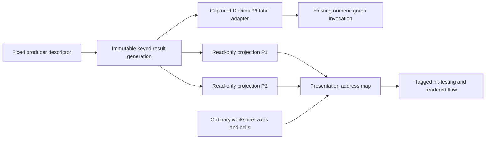

# Structured results and presentation projections

Status: **Proposed design only** under
[ADR-0019](../adr/0019-structured-results-and-projection-identities.md).
No collection/projection implementation or permanent `#` syntax exists.
[Review packet](../handoffs/2026-10-21-structured-results-projection-design.md).

Producer identity answers which result-producing object is bound. Result generation
answers which immutable publication a capture consumes. RecordKey/FieldId answer
which data item is addressed. ProjectionId answers which view is selected. Presentation
ordinals and pixel positions answer only where that view is drawn.

An ordinary A9 remains A9 when a projection between rows 8 and 9 grows. Ordinary
CellIds, scalar bindings and SUM rectangles do not incorporate projected rows.
The presentation map yields either an ordinary worksheet location, a generation-
qualified projection record/field, or projection chrome. It never converts a projected
location into an ordinary cell just because they occupy similar pixels.

Refresh/publication is explicit; recalculation consumes pinned roots without I/O.
A coordinator captures worksheet/graph state and the result map coherently. The
first proof invokes the numeric graph using an exact total from that pinned result;
it does not add a general record-valued graph node or install string values.

The proposed first experiment is read-only, fixed-schema and in-memory. One producer
can have two independently placed views of one result. Key uniqueness, missing-key
errors, canonical numeric reduction and budget refusal are explicit in the ADR.
Worksheet bindings to structured fields, persistent projection documents, concrete
`#` grammar and connectors require later reviewed slices. WB4 must not silently
serialize an experimental document without its projected objects.
