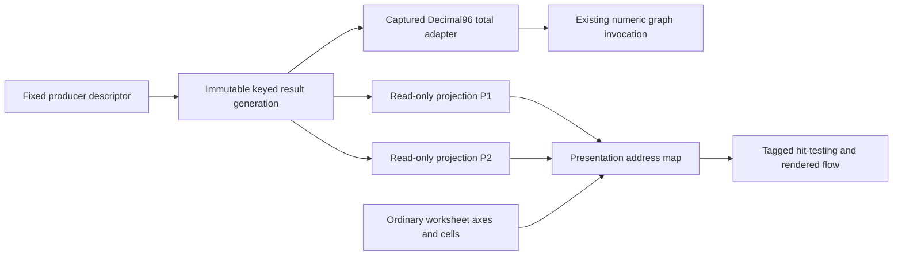

# Structured results and presentation projections

Status: **Bounded experimental proof accepted; milestone closed (2026-10-22)** under
[ADR-0019](../adr/0019-structured-results-and-projection-identities.md).
[Review decision](../handoffs/2026-10-21-structured-results-projection-design-review.md).
[Implementation acceptance and scope closure](../handoffs/2026-10-22-structured-results-projection-implementation-review.md).
The proof is opt-in and in memory. No permanent `#` syntax exists.
The numeric adapter does not establish ordinary worksheet-formula bindings.
Fixed row ordinals are accepted only for the present structurally fixed worksheet;
future row editing requires reviewed anchor identity and affinity semantics.
[Implementation and validation](../handoffs/2026-10-21-structured-results-projection-implementation.md).
[Review packet](../handoffs/2026-10-21-structured-results-projection-design.md).

Producer identity answers which result-producing object is bound. Result generation
answers which immutable publication a capture consumes. RecordKey/FieldId answer
which data item is addressed. ProjectionId answers which view is selected. Presentation
ordinals and pixel positions answer only where that view is drawn.

An ordinary A9 remains A9 when a projection between rows 8 and 9 grows. Ordinary
CellIds, scalar bindings and SUM rectangles do not incorporate projected rows.
The presentation map yields either an ordinary worksheet location, a generation-
qualified projection record/field, or projection chrome. It never converts a projected
location into an ordinary cell just because they occupy similar pixels.

Refresh/publication is explicit; recalculation consumes pinned roots without I/O.
A coordinator captures worksheet/graph state and the result map coherently. The
first proof invokes the numeric graph using an exact total from that pinned result;
it does not add a general record-valued graph node or install string values.

The proposed first experiment is read-only, fixed-schema and in-memory. One producer
can have two independently placed views of one result. Key uniqueness, missing-key
errors, canonical numeric reduction and budget refusal are explicit in the ADR.
Worksheet bindings to structured fields, persistent projection documents, concrete
`#` grammar and connectors require later reviewed slices. WB4 must not silently
serialize an experimental document without its projected objects.

## Implemented proof boundary

`pivot-workbook::projection` contains the fixed InvoiceLines descriptor, typed UUID
identities, immutable keyed generations, canonical checked total adapter and bounded
presentation frames. It is an experimental hidden module, not a collection-valued
core API. LineKey is producer-scoped and the deterministic fixture promises that a
returning key names the same invoice line. Amount is supplied record data; no
per-record computation graph or transformation language has been introduced.

The private `pivot-session` owner coordinates workbook mutation, publication and
composite capture in its single request loop under exclusive `&mut Session` access.
A capture pins the workbook root and current result plus the numeric invocation
model before another request can execute. Evaluation consumes that capture alone.
The private application envelope is now version **3**; versions 1/2 are rejected.
Hosted protocol v1, WB4 and PIVOTCB2/cell-block-v2 remain unchanged.

Two placements use ordinary stable row ordinals in the present fixed 1,024-row
worksheet (there is no axis insertion/deletion API). Projected rows have tagged
header/record/footer locations; they never acquire ordinary Position/CellId values.
The desktop paints the same bounded viewport rather than allocating record controls.
Selection is a key plus producer/generation/projection/field and epoch/map revision;
stale maps and delayed targets are rejected. Removed selected keys become an explicit
missing-record header selection. Scroll reflow preserves a visible ordinary/key anchor.

The proof reserves generation payload/index metadata before cloning, retains one
charge per shared generation, and separately charges capture pins and bounded frame
buffers through the existing runtime allocation domain. Conservative metadata charges
cover descriptor/map overhead; this is domain accounting, not a process-RSS claim.
The response frame charge survives encoding until the next request. Rejecting a
candidate keeps the previous generation, captures and epoch. Numeric core allocations
retain their existing runtime-domain charges; the structured ownership cap is 1 MiB.

Launch `python scripts/run_desktop.py --projections` for the non-savable experiment.
Publication/layout buttons are test scaffolding. There is no automatic refresh or
persistence. The UI advertises the experimental document, refuses Save/Save As before
opening a picker, and uses only Discard/Cancel for a modified proof. Ordinary New/Open
replace the proof only through the existing successful lifecycle/discard boundary.

## Proposed follow-up: ordinary worksheet output bindings

[ADR-0020](../adr/0020-worksheet-structured-output-bindings.md) and its
[review packet](../handoffs/2026-10-22-structured-output-binding-design.md) propose
stable document/producer/output/type operands and one shared scalar source leaf per
referenced numeric output in the canonical graph. The document captures source-head
and result roots and prepares an immutable Decimal96-or-fault context; the core would
not acquire data or understand records. This leaf and fault boundary are proposed
extensions, not implemented capabilities. Rejected candidates retain the prior head;
an explicitly published unavailable head must propagate an error without last-good
fallback. Composite calculation identity includes source roots, not just worksheet
revision. Names resolve only on authoring and projections never participate in binding.
Permanent syntax, persistence, clipboard encoding and code changes await review.
