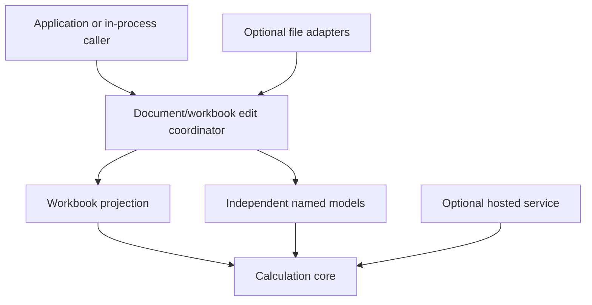

# Workbook ownership and boundaries

Status: Proposed ADR-0010 design; no workbook runtime or dependency changes.

| Concept | Owns or represents | Does not imply |
| --- | --- | --- |
| Document | User-owned content aggregate, dirty/saved state and model/workbook sections | Hosted resource, publication or database store |
| Workbook | Sheet directory, sparse content, cell/graph bindings, names, presentation and calculation settings | Exactly one graph or graph per sheet |
| Worksheet | Stable WorksheetId, ordered axes, sparse content and sheet presentation | A computational model boundary |
| Cell | Stable content/reference anchor with a current sheet/axis position | A1 identity or mandatory executable node |
| Computational graph | Definitions, typed input sources, dependency structure and immutable captures | A grid or file |
| Graph node | Stable computational object/definition behind projection bindings | A visible cell; model nodes may be invisible |
| Named model | Reusable graph definition with explicit interface | Workbook coordinates or mandatory publication |
| Presentation | Styles, row/column geometry, number formats and display preferences | Calculation authority |

A model-only document remains supported with no Workbook. A workbook may project
several sheets onto one active graph, and later contain additional independent
graphs/model definitions. The initial proof should use one workbook computation
graph across its sheets. This simplifies coherent edits without making that shape
a permanent document-format restriction.

Named models remain directly invocable through captured public interfaces. A sheet
can expose or edit ports/nodes from a model participating in its active graph through
explicit bindings. Cross-graph call nodes, input wiring and evaluation scheduling
are later computational designs, not implicit behavior of placing a model on a
sheet. External models must eventually pin identity/version/content; no automatic
path lookup or network refresh is introduced here.

The diagram expresses dependencies, not a requirement that the file broker invoke
a live session to inspect data. File adapters serialize immutable owned captures;
the core never calls filesystem or GUI code. Ordinary local Save remains independent
of hosted publication. A future workbook envelope must preserve its projection and
graph definitions together, but this ADR selects no container or byte layout and
does not extend the current model-only experimental format.

## Implementation placement

Propose a dedicated Rust workbook boundary, provisionally pivot-workbook, when the
first implementation is approved. It can depend on pivot-core/pivot-types and own
sparse sheets, reference resolution, edits and viewport-independent reads. It must
not depend on Avalonia, transport, SQL providers or a hosted registry.

The application/session coordinator composes workbook and document lifecycle.
Persistence adapters consume portable captures and own codec/filesystem behavior.
Current document sessions happen to live in pivot-storage; preserve them rather
than moving them as a prerequisite. If future aggregate ownership creates a genuine
dependency cycle, review a pivot-document split then. Do not add sheet/projection
logic to storage merely because its current module is convenient.

C# owns interaction, rendering and editing overlays. Rust owns submitted formula
interpretation, binding, calculation and committed workbook state. Direct in-process
Rust and out-of-process applications use the same semantic operations; a daemon
is an adapter, not a requirement for a workbook or model to calculate.

## State distinctions

Keep DocumentId as logical ancestry, SessionId as loaded-instance authority, stable
WorksheetId/CellId as projection identities, and portable graph/node/port identities
as computational identities. Neither labels nor coordinates authorize cross-session
access. Runtime core handles stay private and are freshly allocated on restoration.

An installed document state identifies the whole coherent aggregate. Its graph
revision identifies computational state; calculations have generation provenance.
Projection, format and geometry component versions may later permit selective cache
reuse, but do not allocate a framework of new UUIDs before those caches exist.
The first proof can use DocumentStateId for all workbook reads and the existing
graph revision for calculations. Saved-file version/fingerprint remain broker concerns.

Original formula source and exact decimal data remain owned authoritative content.
Dependency order, viewport caches, formatted strings and calculation results are
derived. Calculation snapshots pin every definition/input/selection root they use;
document edits remain available while that immutable generation runs.
