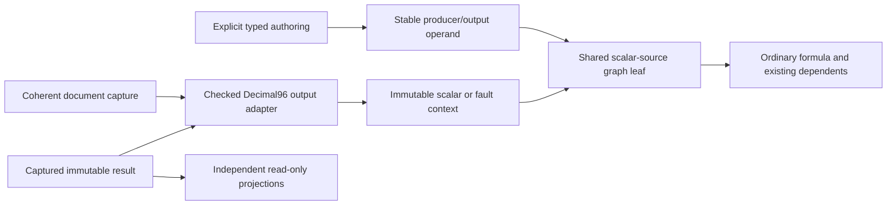

# Worksheet structured-output binding — design review packet

Date: 2026-10-22. **Design and addendum accepted for the bounded experiment; experimental implementation now in place; three-platform validation complete; parent implementation review pending.**
[Contract acceptance](2026-10-22-structured-output-binding-contract-review.md). Earlier review requests below are design history;
the accepted addendum and its two clarifications now govern implementation.
[Parent decision](2026-10-22-structured-output-binding-design-review.md), [focused contract addendum](2026-10-22-structured-output-binding-contract-addendum.md).
The original decision requests below are retained as design provenance; the linked
review approves direction and requires the addendum before implementation.
The user authorized design work after the accepted ADR-0019 proof.
[ADR-0020](../adr/0020-worksheet-structured-output-bindings.md),
[preceding acceptance](2026-10-22-structured-results-projection-implementation-review.md).

The proposal binds an ordinary formula to `(DocumentId, ProducerId, OutputId,
ExpectedType)`, never a name or projection. Start with the fixed Decimal96 TotalAmount
contract. Name lookup occurs only during explicit authoring; rename and projection
movement preserve old bindings, while deleting/recreating the same label does not.
Permanent `#` grammar remains undecided.

The main implementation proposal needing review is one shared captured scalar-source
leaf in the canonical graph per referenced output. The document prepares an immutable
Decimal96-or-fault context from one coherent captured head/result map. This is a
proposed core scalar-boundary extension, not an already available API, collection
runtime or competing evaluator. It avoids hidden ordinary inputs and per-record nodes.

## Decisions requested from parent

1. Approve identity-bound scalar outputs as the next narrow experiment; leave keyed
   record access, permanent grammar and persistence separate.
2. Approve capture-local scalar-source leaves and typed fault propagation rather than
   mutating live adapter values or rewriting formulas to literals.
3. Approve distinct rejected publication attempts versus authoritative unavailable
   source heads. Retained valid heads remain usable with visible attempt diagnostics;
   a captured unavailable head must never fall back to cached last-good values.
4. Approve exact composite binding/capture authority and capture-qualified evaluation
   identity. Worksheet revision alone cannot validate source-dependent results.
5. Approve same-document copy retaining producer/output identity and atomic rejection
   of foreign native bindings; review concrete experimental authoring/clipboard and
   byte-admission details before any implementation.

## Proposed adversarial acceptance matrix

| Case | Required outcome |
| --- | --- |
| Rename producer/output; move/hide/delete both projections | Existing formula retains target and numeric value |
| Delete producer/output; recreate same labels | Existing formula errors; explicit resubmission alone rebinds |
| Unresolved initial name then create it | Invalid draft stays isolated until explicit resubmission |
| Foreign document identity or stale authoring directory | Reject command atomically; no same-name substitution |
| Two formulas consume the same output | One shared adapter slot and ordinary canonical dependency edges |
| Publish 0 / 3 / 5 records | Bound ordinary formula and its dependents see 0 / 60 / 150 totals |
| Duplicate/missing keys or budget failure during staging | No head/epoch/value installed; prior state and captures survive |
| Explicitly publish unavailable after successful result | New capture errors; old capture remains valid; no cached fallback |
| Captured output overflow / schema or type mismatch | Explicit origin-preserving fault; independent cells still evaluate |
| Compute S1 while W2/G2 publishes | S1 retains its own worksheet/head roots; S2 consumes new roots |
| Cell edit and publication are separate commands | Intervening capture is valid committed state, not false combined atomicity |
| Repaint/recalculate repeatedly | No acquisition, publication or new record materialization |
| Reverse a view with order-sensitive overflow fixture | Computation stays in canonical record order |
| Copy mixed ordinary/structured formula within document | Translate only A1 operands; preserve output identity |
| Native cross-document rectangle contains structured operand | Reject whole paste; no partial changes or text fallback |
| Late result arrives after new publication | Current view rejects it; explicit old-capture inspection remains possible |
| Two retained captures plus staged publication exceed budget | Reject admission without eviction, ID reuse or truncated results |
| Experimental Save/Save As and dirty close | Refuse save; explicit Discard/Cancel; normal WB4 remains unchanged |

This is a future acceptance plan, not a claim these tests or behaviors are implemented.
Actual acceptance must include real C#–Rust ordinary-formula evaluation and managed/
Native AOT desktop gates on Windows, native Linux/WSLg and macOS/APFS, with zero-charge
cleanup and source provenance. Reuse integrated automation; no recurring manual replay.

## Limits and stop

ADR-0019 remains accepted and closed. No code, schema, protocol, clipboard or file
version changed for this design. No new benchmark or platform validation was run or
needed for documentation. Historical platform defects remain separate.

Submit ADR-0020 and this packet for parent design review. Implementation must wait
for approval of the scalar-boundary and publication semantics and a concrete bounded
authoring/clipboard/admission plan. Persistence, WB5, permanent syntax, connectors,
refresh scheduling, generalized collections and row-anchor structural policies are
not bundled into this proposal.

Implementation follow-up: [bounded proof and validation evidence](2026-10-22-worksheet-structured-binding-implementation.md).
The proposal and review language above records the design phase; implementation acceptance is separate.
