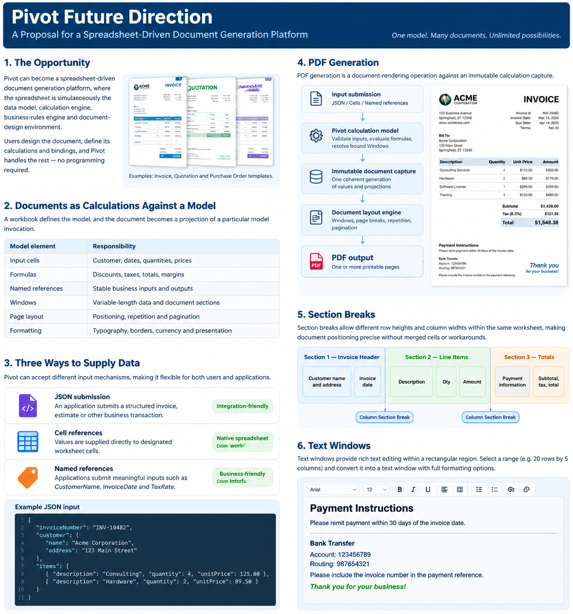
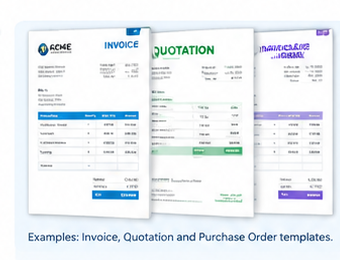
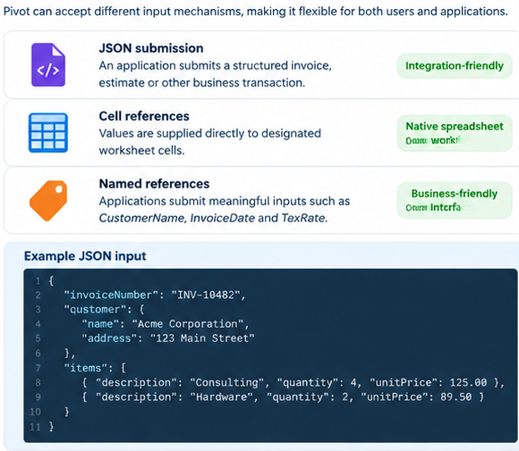
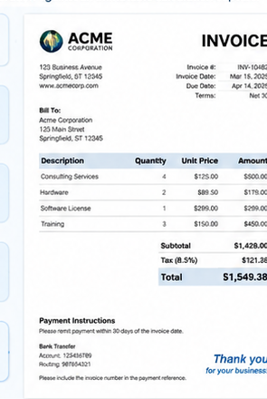
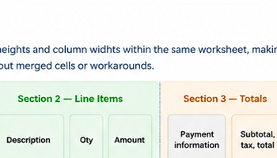
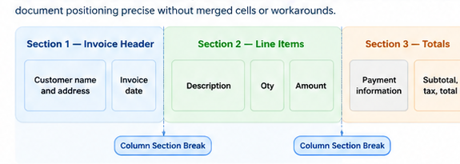
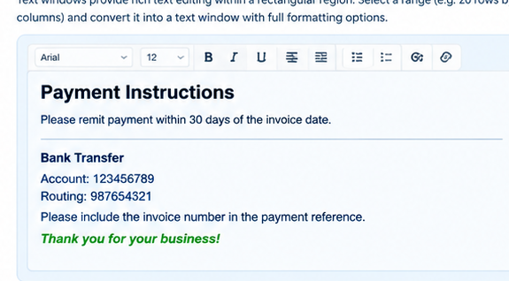

# Pivot Future Direction

**Proposal:** Spreadsheet-driven document generation, named Windows, Section Breaks and Text Windows  
**Status:** Exploratory proposal for architectural discussion  
**Date:** 2026-11-01



## 1. The opportunity

Pivot could grow from a spreadsheet application into a configurable business-document platform. A workbook would define not only data and calculations, but also business rules, document structure, layout and presentation. Users could design invoices, estimates, purchase orders, statements, work orders and similar documents in a familiar spreadsheet environment, then generate consistent documents from supplied data without writing or maintaining a custom application.

The central idea is that a document is a **projection of a particular calculation-model invocation**. A company could maintain one invoice template and use it to generate thousands of invoices from different input datasets. Changing branding, calculations, terms or layout would mean editing the workbook/template rather than reprogramming a bespoke application.

This is not simply printing a spreadsheet. It is using a spreadsheet-defined model to generate business documents.

### The workbook defines the model

| Model element | Responsibility |
|---|---|
| Input cells | Customer, dates, quantities, prices and other supplied values |
| Formulas | Discounts, taxes, totals, margins and business rules |
| Named references | Stable, meaningful business inputs and outputs |
| Windows | Independently addressed regions, including variable-length or bound content |
| Page layout | Placement, repetition, page visibility and pagination |
| Formatting | Typography, borders, currency presentation and visual design |



A single model/template could produce invoices, estimates/quotations and purchase orders. The examples are illustrative rather than a frozen UI or document specification.

## 2. Supplying data to the model

The model should be invocable through several complementary input mechanisms.

### JSON submission

An application could submit a structured transaction, such as an invoice:

```json
{
  "invoiceNumber": "INV-10482",
  "customer": {
    "name": "Acme Corporation",
    "address": "123 Main Street"
  },
  "items": [
    { "description": "Consulting", "quantity": 4, "unitPrice": 125.00 },
    { "description": "Hardware", "quantity": 2, "unitPrice": 89.50 }
  ]
}
```

The template defines how the supplied structure maps to model inputs and bound content. The caller need not know how the invoice is calculated or laid out; it needs to know the input contract.

### Cell references

Values can be supplied directly to designated worksheet cells. This is the natural route for an interactive Pivot workflow or an integration that already knows the template's cell contract.

### Named references

Applications should also be able to submit meaningful names such as `CustomerName`, `InvoiceDate`, `TaxRate` or `InvoiceNumber`, rather than depending exclusively on cell addresses. Named references provide a more stable and business-friendly integration surface.



The input mechanisms should converge on the same canonical model and calculation path. They should not create separate calculation engines or subtly different formula semantics.

## 3. From model to PDF

PDF generation should be a document-rendering operation against an immutable calculation capture, independent of the Avalonia desktop application. The same template should be renderable by a desktop workflow, a headless process or a service.

Proposed flow:

1. **Input submission** — JSON, worksheet cells or named references.
2. **Pivot calculation model** — validate inputs, evaluate formulas and resolve bound Windows.
3. **Immutable document capture** — capture one coherent generation of values and projections.
4. **Document layout engine** — place ordinary content and Windows, apply page rules and paginate.
5. **PDF output** — produce one or more printable pages.

The immutable capture is essential. Customer details, line items, totals and other values in one generated document must come from the same coherent calculation generation. Rendering must not mutate the workbook, allocate computational identities or advance workbook revisions.



A database-bound Window must not unexpectedly execute a query merely because a document is rendered. Rendering consumes the selected, already-captured source generation. Refreshing an external source is a separate explicit action.

PDF is the obvious first output target. Other output formats can be considered separately once the document model and layout contract are established.

## 4. Named Windows

A **Window** is a named, independently addressed region with its own coordinate space. Within a Window, cell ordering starts again at A1. A Window may own its contents or present content supplied by a bound producer.

The proposed reference syntax is:

- `SheetName!A1` for worksheet references.
- `WindowName|A1` for Window references.

The pipe syntax is exploratory and requires grammar, identity, binding and fault-semantics review before it is frozen.

### Window ownership modes

**Unbound Window** — content is entered directly into the Window's own coordinate space. It owns its authored content, formulas and formatting under the eventual Window identity model.

**Bound Window** — content is supplied by a producer, such as a worksheet range or a database query. Binding describes the source; it does not imply write-back.

Bound should be an ownership/source mode, not a separate visual Window type. A Grid Window or Text Window could each be bound or unbound.

### Window presentation types

- **Grid Window:** a conventional cell grid with its own coordinate space, suitable for tables, calculations and variable-length records.
- **Text Window:** a rich-text surface occupying a rectangular region, described further below.

A Window should have a visually distinct region: a border, contrasting background or surrounding gap, and a header identifying its name. A compact control area at the upper-right can contain a refresh button where applicable and a contextual menu for binding, source and layout properties.



### Worksheet-bound and database-bound refresh behavior

Different source types should have different refresh policies.

**Worksheet-range binding: live within Pivot.** When a committed workbook mutation changes a bound source range, the affected Window should update automatically. The new projection should be calculated against a coherent workbook generation and published as a whole. A Window must never show a mixture of old and new source generations. Formula values should come from the appropriate immutable calculation capture.

**Database-query binding: explicit snapshot refresh.** External query results should remain unchanged until the user explicitly requests refresh, using the circular-arrow refresh control. A database may change at any moment; silently changing a report or invoice while it is being reviewed or printed is undesirable.

A failed external refresh should preserve the last successful snapshot and visibly indicate that the displayed data may be stale or that the latest refresh failed. Refresh is not recalculation, and rendering is not refresh.

| Operation | Meaning |
|---|---|
| Recalculation | Re-evaluate formulas against current workbook state |
| Live Window update | Rebuild a projection after a committed worksheet-source mutation |
| External refresh | Execute a database query and capture a new source generation |
| Pagination | Reflow existing Window content into physical pages |

There should be no implicit write-back to the original database or source range. A bound Window is initially read-only unless a separately designed, explicit write-back capability is introduced later.

### Ordinary page content is not necessarily a Window

Not every printable item needs to become a Window. Static invoice headings, customer labels, logos, notes and payment terms can remain ordinary worksheet/page-associated content. Their presence in a page layout can imply that they appear on each page occupied by that layout.

A separate page-visibility rule can express first-page-only, last-page-only, once-only or every-page behavior. Such content does not need an independent coordinate space merely because it is printed.

A Window is appropriate when content needs its own coordinate space, binding/ownership, variable extent or independent flow/pagination behavior.

## 5. Section Breaks and local worksheet geometry

A worksheet currently has one row-height and column-width regime. That forces document designers to compromise when different portions of a document need different geometry. Users work around this with spacer rows/columns, merged cells and awkward formatting.

A **Section Break** would start a new geometry regime. After a column Section Break, subsequent columns can have different widths. After a row Section Break, subsequent rows can have different heights. These are independent break types: either can exist without the other, or both can occur at the same boundary.

For example, an invoice header might need a broad customer-address area and a narrow date area, while the line-item section needs a wide description column and narrow quantity/price columns. The totals section may need yet another arrangement.



### Proposed invariants

- A cell's logical address does not change because of a Section Break. G25 remains G25.
- CellIds, GraphNodeIds, formula references, selection identities, range semantics, sorting and filtering remain computationally unchanged.
- Section Breaks are document-owned structural/presentation metadata, separate from cell formatting.
- Formatting remains associated with logical positions under existing formatting semantics; a break does not reset formatting.
- A Section Break is not automatically a physical page break. Geometry and pagination are separate concepts.
- Row and column geometry partitions should initially be independent rather than creating a potentially large two-dimensional region grid.

The renderer and interactive viewport would map logical coordinates to physical positions using the relevant section geometry. Inserting or deleting rows/columns across a break requires an explicit boundary-affinity policy; it should reuse established structural-editing principles where appropriate rather than inventing implicit behavior.

## 6. Text Windows: rich text within a worksheet region

A user could select a rectangular area, such as A1:E20, and convert it into a **Text Window**. The selected region becomes one logical text-editing surface rather than twenty rows by five independently editable cells.

This is conceptually similar to merging cells and enabling multiline wrapping, but it should be a first-class object rather than a special case of merged cells.



A Text Window should support:

- Multiline editing and automatic word wrapping.
- Horizontal and vertical alignment, including centering.
- Font family, size, weight, color and decoration.
- Character-level formatting, including bold and italic.
- Paragraph alignment, spacing and indentation.
- Bulleted and numbered lists as a possible supported rich-text structure.
- Padding/internal margins, borders and background.
- Optional hyperlinks.
- Explicit inline calculated references.

For example, payment instructions, legal terms, customer notes or a variable description could be authored in a Text Window rather than simulated with merged cells and manually adjusted row heights.

### Rich-text representation

The initial design should investigate a bounded rich-text document model consisting of paragraphs, text runs, character formatting, paragraph formatting and explicit inline references. It should not embed arbitrary HTML or create a second general-purpose rendering engine.

Inline values such as `CustomerName` or `OrderTotal` should eventually be represented as typed, bound text runs rather than blind string substitution. The calculation model resolves values; the text/document renderer handles layout and presentation.

### Text Window overflow

Potential overflow policies include:

| Policy | Behavior |
|---|---|
| Clip | Content beyond the allocated area is not displayed |
| Shrink | Reduce font size within defined limits |
| Expand | Grow the region |
| Flow | Continue onto subsequent pages |

A flowing Text Window remains one logical editable object. Pagination must not split its underlying text into separate worksheet objects.

Converting a cell rectangle into a Text Window is a structural operation. The design must define how existing cell contents, formulas, identities and formatting are preserved, rejected or transformed. Conversion back to a grid should be considered, but must not promise reversibility until a lossless mapping is defined.

## 7. Document layout, repetition and pagination

Windows and ordinary page content are placed in a document layout. The layout determines where regions appear, which pages they appear on, and how flowing content occupies printable space.

A variable-length LineItems Window might have a fixed width and flowing height. If the printable area accommodates eight lines per page and the source contains 23 lines, the renderer produces three page projections: lines 1–8, 9–16 and 17–23.

The logical Window still contains 23 entries. Pagination does not create new worksheet rows, identities or workbook revisions.

Potential page-visibility rules for ordinary content and Windows include:

- Every page.
- First page only.
- Last page only.
- Once only.
- Continue until exhausted (for flowing content).

Repeated column headings for a line-item table, final-page totals and first-page invoice details are examples of layout behavior. Nested Windows should be deferred initially; sibling regions provide a simpler first model and avoid recursive layout/overflow interactions.

## 8. Architectural separation

The concepts should remain separate, even though they work together:

| Layer | Responsibility |
|---|---|
| Calculation model | Inputs, formulas, identities, dependencies and calculations |
| Data producer/binding | Supplies a coherent source generation to a bound Window |
| Window | Named coordinate space, ownership mode, content and local presentation |
| Document layout | Places ordinary content and Windows; defines page visibility and flow |
| Section geometry | Defines local row-height and column-width regimes |
| Text layout | Lays out rich text, inline references and paragraphs |
| Document renderer | Consumes an immutable capture and produces page projections/PDF |

The renderer must not become a second calculation engine. Windows must not create synthetic computational cells merely to paginate. Database access must not occur as a side effect of ordinary calculation or rendering. A source refresh creates a new snapshot; rendering consumes a selected immutable snapshot.

A Window may be displayed interactively and printed, but interactive presentation and physical-page projection need not share identical viewport behavior.

## 9. Potential business applications

The same model could support:

- Invoices with variable line items and final-page totals.
- Estimates and quotations with configurable pricing rules.
- Purchase orders and delivery receipts.
- Customer statements and account summaries.
- Payroll summaries and employee statements.
- Inventory and product listings.
- Financial and operational reports.
- Work orders and service documentation.

The common pattern is a model with inputs and calculations, one or more bound/unbound presentation regions, and a document layout that can produce one or more pages.

## 10. Proposed design work and boundaries

This is a future-direction proposal, not an approved implementation plan. The following are candidate design areas and should be separated into coherent ADRs after architecture review:

1. **Named Windows and binding architecture:** identities, independent coordinate spaces, unbound content, worksheet-range binding, database-query snapshots, refresh policy and reference grammar.
2. **Section geometry and document layout:** independent row/column Section Breaks, ordinary page-associated content, Window placement, page visibility, flow and pagination.
3. **Text Windows:** bounded rich-text objects, editing, conversion from/to cell regions, inline bindings and text overflow.
4. **PDF rendering:** a headless renderer consuming immutable captures and producing paginated documents.
5. **External model invocation:** JSON, cell and named-reference input contracts, validation, calculation and document-generation invocation.

These are possible boundaries, not a frozen order or authorization. Existing structured-result/projection work should be reviewed and reused where its semantics fit; this proposal does not assume that it can simply be renamed or folded into Windows without changes.

### Initial exclusions to consider

- Implicit write-back to external data sources.
- Automatic database refresh during calculation or rendering.
- Nested Windows and recursive layout.
- General-purpose HTML embedding.
- Arbitrary query languages or a second calculation engine.
- Unbounded arrays/spills as a prerequisite for Windows.
- Hidden workbook mutations during pagination or PDF rendering.
- Automatic business-record association or repair after sorting/structural changes.

## 11. Open design questions

1. Are Windows document-owned objects, worksheet-owned objects, or members of a separate document-layout model?
2. What is the precise identity and reference contract for cells in unbound Windows versus projected values in bound Windows?
3. How do Window coordinates, SelectionIds and source identities survive edits, source refreshes and structural changes?
4. What source types are supported initially: worksheet ranges, structured results, database queries, named values or some subset?
5. How are immutable source generations captured and retained, especially when a database refresh fails?
6. How do worksheet-bound Windows subscribe to committed changes without creating a second dependency/calculation authority?
7. How are Section Breaks anchored and transformed by row/column insertion and deletion?
8. How does the renderer measure fonts, wrap text, paginate variable-height content and remain deterministic across platforms?
9. How are first-page/last-page/once/every-page rules represented for ordinary content?
10. What does converting a cell rectangle to a Text Window preserve, and what must be rejected to avoid identity or data loss?
11. How are inline references represented, formatted and faulted when their source is missing or invalid?
12. What PDF font embedding, Unicode, accessibility, security and reproducibility requirements apply?
13. How are templates versioned and invoked by external applications without requiring the desktop UI?

## 12. Proposed principle

**One model. Multiple presentation surfaces.** Pivot's calculation engine remains authoritative for data and calculations; Windows provide named presentation coordinate spaces; Section Breaks provide local geometry; Text Windows provide rich text; and the document renderer turns an immutable capture into pages and PDF output.

The goal is to let a business design and evolve its own document-generating application in a spreadsheet environment, without requiring custom software development for every change.
